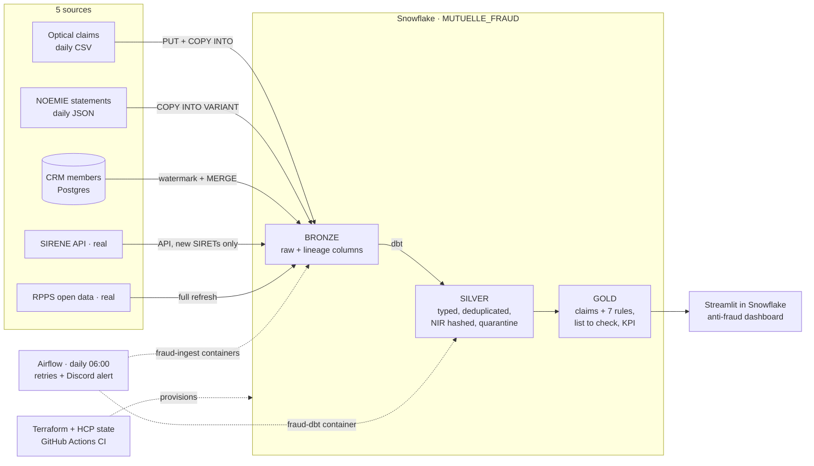

# Mutuelle Horizon Santé · optical claims fraud detection

Fictitious French health mutual (300,000 members, ~250 M€ of contributions a year). Optical care is the main target of
health-insurance fraud in France (53 % of the 112 M€ detected in 2025). Every morning at 06:00, a daily batch pipeline gives
the anti-fraud manager the list of **optical claims to check before paying them**, scored with 7 fraud rules (F1–F7).
Goal: block about **0.5 M€ of optical fraud a year**, before payment.

Data Engineering & Cloud Infrastructure, Albert School · Group 1: Lucas Stefani (sources → BRONZE),
Clément Badalucco (dbt SILVER / GOLD, dashboard), Eliott Monneraie (platform: Terraform, Airflow, CI, security, costs).

## Architecture



| Source | Real or simulated | Ingestion method | BRONZE table |
|---|---|---|---|
| Optical claims (tiers payant + member app) | simulated, frauds injected | batch files: `PUT` + `COPY INTO` | `FACTURES_OPTIQUE` |
| NOEMIE statements (Sécurité sociale) | simulated | batch semi-structured: `COPY INTO` a `VARIANT` | `NOEMIE_DECOMPTES` |
| CRM members and contracts (Postgres) | simulated | incremental pull: `UPDATED_AT` watermark + `MERGE` | `ADHERENTS` (minimised: no name, NIR or address) |
| Opticians, SIRENE (API Recherche d'entreprises) | **real** | API pull, only SIRETs never checked | `SIRENE_ETABLISSEMENTS` |
| Ophthalmologists, RPPS (Annuaire Santé) | **real** | reference data, full refresh | `RPPS_PRESCRIPTEURS` |

Real health claims cannot be obtained (medical secrecy, GDPR art. 9), so the 3 operational sources are simulated on the real
formats, with real SIRET / RPPS numbers (never labelled as fraudsters) and the real regulatory ceilings of the *contrat responsable*.
Details: [`docs/contracts.md`](docs/contracts.md).

| Tool | Why | Credible alternative |
|---|---|---|
| Snowflake | storage / compute separation, per-second billing, RBAC | BigQuery |
| Python jobs in Docker | one method per source, same image on every machine | Airbyte, dlt |
| dbt | medallion layers, tests, lineage | SQL in Snowflake Tasks |
| Airflow (DockerOperator) | schedule, retries, backfill, alerting | Snowflake Tasks, Dagster |
| Terraform + HCP Terraform state | reproducible, reviewed in PR, drift detection | Pulumi, manual SQL |
| Daily batch | the business decision is daily | streaming: cost and complexity for nothing |

## Repository

| Folder | What | Owner |
|---|---|---|
| `data_generator/` | official data set (`--seed 42`), injected frauds, answer keys, `validate.py` (executable specification), real references frozen in `ref/` | Lucas |
| `ingestion/` | one job per source, BRONZE DDL, image `fraud-ingest:1.0.0` | Lucas |
| `transformation/` | dbt project `mutuelle_dbt`, image `fraud-dbt:1.0.0` | Clément |
| `dashboard/` | Streamlit in Snowflake app | Clément |
| `airflow/` | DAG `mutuelle_fraud_daily`, Airflow image | Eliott |
| `terraform/` | Snowflake infrastructure as code, `bootstrap_admin.sql` | Eliott |
| `.github/workflows/ci.yml` | on every PR: `terraform fmt` + `validate`, data generation + `validate.py` | Eliott |
| `docs/` | contracts, ingestion runbook, security, FinOps, incidents, demo, proofs (`docs/preuves/`) | all |

## Run it from scratch

Commands run from the repo root on the demo machine (Mac with Docker Desktop, Python 3.12, Terraform ≥ 1.9).
Secrets never go in Git: keys stay in `~/keys/mutuelle`, values in `.env` and `airflow/.env` (both gitignored).

**1. Keys of the service accounts** (once). Only the public keys leave the machine, as Terraform variables.

```bash
mkdir -p ~/keys/mutuelle
for k in svc_ingest svc_transform; do
  openssl genrsa 2048 | openssl pkcs8 -topk8 -inform PEM -out ~/keys/mutuelle/$k.p8 -nocrypt
  openssl rsa -in ~/keys/mutuelle/$k.p8 -pubout -out ~/keys/mutuelle/$k.pub
done
chmod 600 ~/keys/mutuelle/*.p8
```

**2. Snowflake platform.** In Snowsight with ACCOUNTADMIN, run blocks 1 to 3 of
[`terraform/bootstrap_admin.sql`](terraform/bootstrap_admin.sql) (users, `SVC_TERRAFORM`, resource monitor), then:

```bash
cd terraform && cp terraform.tfvars.example terraform.tfvars   # fill in, public keys included
terraform login && terraform init                               # state on HCP Terraform
terraform plan && terraform apply && terraform plan             # the last plan must say "No changes"
cd ..
```

Then block 4 of `bootstrap_admin.sql` (resource monitor attached to the 3 warehouses). Details: [`terraform/README.md`](terraform/README.md).

**3. Official data set.**

```bash
python3 data_generator/generate.py --seed 42                   # 10 days (26/10 → 04/11) + 24 months of history + NOEMIE incident on 30/10
python3 data_generator/validate.py --data data --each-day      # expected: VALIDATION OK (100 % recall, 0 false positive, exact quarantine)
```

**4. Images and CRM.**

```bash
cp .env.example .env                                           # SNOWFLAKE_USER=SVC_INGEST, key /secrets/svc_ingest.p8
docker build -t fraud-ingest:1.0.0 ingestion/
docker build -t fraud-dbt:1.0.0 transformation/
docker compose -f docker-compose.crm.yml up -d --wait          # Postgres CRM on port 5433
run() { docker run --rm --env-file .env -v "$PWD/data:/data" -v "$HOME/keys/mutuelle:/secrets:ro" fraud-ingest:1.0.0 python -m "$@"; }
run jobs.seed_postgres --date history                          # 8,000 members
```

**5. BRONZE and history** (runbook: [`docs/part1_sources_bronze.md`](docs/part1_sources_bronze.md)).

```bash
run jobs.bootstrap_bronze
run jobs.load_invoices --date history
run jobs.load_noemie --date history
run jobs.load_adherents_incremental                            # first run = full load
run jobs.load_rpps --reuse-extract                             # frozen RPPS extract
```

**6. Airflow.**

```bash
cd airflow && cp .env.example .env     # ABSOLUTE paths of data/ and ~/keys/mutuelle, NIR_SALT, DISCORD_WEBHOOK_URL, PIPELINE_DRY_RUN=0
docker compose up -d --build && cd ..  # http://localhost:8080, the DAG starts paused
```

**7. Daily loads up to 03/11.** In Airflow: *Déclencher* → *Rattrapage*, logical dates **27/10 06:00 → 04/11 06:00**
(batches 26/10 → 03/11). A backfill stays queued while the DAG is paused: unpause it during the backfill, then pause it again.
The run of 31/10 (batch 30/10) is red on purpose (NOEMIE incident) and the next one is green.
At the end, check that the last batch in GOLD is 03/11; otherwise run dbt for 03/11 (step 8).
Without Airflow: `run jobs.run_day --date <D> --simulate-crm` for each day, then step 8.

**8. dbt by hand (optional) and dashboard.**

```bash
set -a; source <(grep -E '^(NIR_SALT|SNOWFLAKE_ACCOUNT)=' airflow/.env); set +a
docker run --rm -e SNOWFLAKE_ACCOUNT -e NIR_SALT -e SNOWFLAKE_USER=SVC_TRANSFORM -e SNOWFLAKE_ROLE=TRANSFORM_ROLE \
  -e SNOWFLAKE_WAREHOUSE=TRANSFORM_WH -e SNOWFLAKE_DATABASE=MUTUELLE_FRAUD -e SNOWFLAKE_PRIVATE_KEY_FILE=/secrets/svc_transform.p8 \
  -v "$HOME/keys/mutuelle:/secrets:ro" fraud-dbt:1.0.0 dbt build --vars '{batch_date: 2026-11-03}'
# expected: PASS=46 WARN=0 ERROR=0
```

Dashboard: Snowsight → Projects → Streamlit → `DASHBOARD_ANTI_FRAUDE` (about 1 minute to start). On a new account, create it first with `dashboard/streamlit_app.py`: [`dashboard/README.md`](dashboard/README.md).

## How a day runs

DAG `mutuelle_fraud_daily`, every day at 06:00 Europe/Paris. **The run of day D processes the batch of D-1**
(`batch = ds - 1`), so replays and backfills always target a past batch.

```
crm_activity → ingest_adherents ──────────────────┐
             → ingest_factures → check_sirene ────┼→ dbt_build
             → ingest_noemie ─────────────────────┘
```

Each task is a container (`fraud-ingest` with `SVC_INGEST`, `fraud-dbt` with `SVC_TRANSFORM`), 2 retries, one run at a time,
Discord alert after the last failure. Every job writes one line in `BRONZE.LOAD_AUDIT`; dbt writes its results in `OPS.DBT_RESULTS`.
Lineage: `dbt docs generate && dbt docs serve` in `transformation/`.

## Quality and incidents

- `validate.py` recomputes every rule independently of dbt; CI runs it on every PR.
- 31 dbt tests (a green `dbt build` = `PASS=46`: 9 models, 4 seeds, 31 tests, 2 hooks), among them: recall ≥ 80 % of the
  injected frauds, **0 false positive**, exact quarantine, NOEMIE batch present, quarantine below 15 %.
- Both incidents were replayed for real on 03/11, proofs in [`docs/incidents.md`](docs/incidents.md) and [`docs/preuves/`](docs/preuves/):
  1. **Replay without duplicates**: rerunning `ingest_factures` gives `ALREADY_LOADED`, 0 row (COPY load history, MERGE on key).
  2. **Late NOEMIE file (30/10)**: `NO_FILE`, the completeness test fails, GOLD is not published (15 nodes skipped),
     Discord alert after 3 attempts; the next batch brings both days and everything is green again without any action.

## Live demo (Thursday 05/11)

One gesture only: **unpause the DAG**. Airflow then creates the scheduled run of 05/11 06:00, which processes the batch of
**04/11**. Do not click *Déclencher*: it unpauses the DAG by default and would add a second run on the same batch.
Full procedure: [`docs/demo.md`](docs/demo.md).

## Reset (rehearsals, video)

```bash
run jobs.reset_demo --yes        # TRUNCATE BRONZE (also clears the COPY load history), empties the stage, drops the CRM table
```

Then steps 4 (`seed_postgres`), 5 (history loads) and 7 (backfill). SIRENE / RPPS are kept (`--with-references` empties them too).

## Security and costs

- One role per layer, one service account per layer (RSA key only), the grader only reads SILVER / GOLD / OPS, `ANALYST_ROLE`
  only reads the daily KPI. NIR hashed with a secret salt in SILVER. No secret in Git. [`docs/security.md`](docs/security.md)
- 3 XSMALL warehouses with 60 s auto-suspend, a 20-credit monthly resource monitor that suspends the 3 warehouses at 100 %,
  Airflow and Docker on the demo machine (0 €). The dashboard compute pool is not covered by the monitor: stop the app after use. [`docs/finops.md`](docs/finops.md)
- Shutdown after grading: [`docs/finops.md`](docs/finops.md), section 5 (`terraform destroy` + manual clean-up).

Rules of the repo: no direct push on `main`, one branch and one reviewed pull request per change.
All people, NIR numbers and claims are fictitious.
